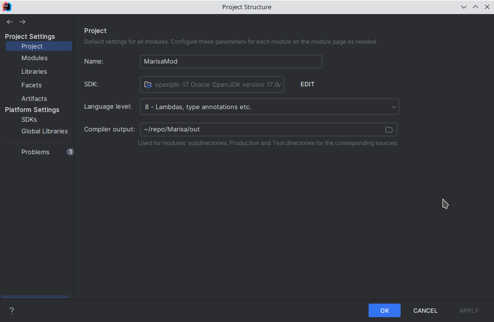

# Contributing

Thank you for helping with Marisa: Continued. To add or fix a translation, read [LOCALIZATION.md](LOCALIZATION.md).

## Build from source

> [!WARNING]
>
> The development environment is only tested on Linux. It may not work on other systems.

1. Install [Deno](https://deno.com), JDK 17 and [Slay the Spire][sts] with [ModTheSpire][modthespire] and [BaseMod][basemod].
2. Clone the repository: `git clone https://github.com/scarf005/Marisa.git`
3. In IntelliJ, set up Java, Kotlin and Gradle. The language version must be 8.

   

4. Copy `gradle.properties.example` to `gradle.properties`. Set `userSteamDir` to your Steam directory that ends with `/steamapps`.

   ```
   # fill in your steam directory ending with '/steamapps'
   userSteamDir=/home/scarf/.local/share/Steam/steamapps
   # default: "$userSteamDir/workshop/content/$gameSteamId"
   workshopDir=
   ```

5. Build the mod jar to `build/libs/marisa.jar`:

   ```sh
   ./gradlew jar
   ```

6. To copy the jar into your Steam mods folder, run the `changelog` task. Run it once, or with `-t` to build again when a file changes:

   ```sh
   ./gradlew changelog
   ./gradlew -t changelog --warning-mode all
   ```

[sts]: https://store.steampowered.com/app/646570/Slay_the_Spire/
[modthespire]: https://steamcommunity.com/sharedfiles/filedetails/?l=koreana&id=1605060445
[basemod]: https://steamcommunity.com/sharedfiles/filedetails/?id=1605833019

## Tests

Run the Deno changelog and localization unit tests from the repository root:

```sh
deno task test
```

This excludes `releases_test.ts`. That file checks a locally installed release and its hard links.

Kotlin tests need JDK 17 for Gradle and the game (with its bundled `jre/`), BaseMod, and ModTheSpire under the Steam library in `gradle.properties`:

```sh
./gradlew test
```

Tests do not need the generated `docs/changelog/` files. Packaging and publishing need them.

`patchGame` applies the ModTheSpire patches of BaseMod and this mod to the game classes. The tests then boot that patched game headlessly on the game's own JRE and play cards in a first-act fight. Configs and preferences go to `build/test-workdir/`. The report is in `build/reports/tests/test/index.html`.

Snapshots in `src/test/snapshots/` record every card, relic, potion and power, what each card does when played, a turn with each power and relic, fights against Orin and Zombie Fairy, and the choices of the mod's events. After an intended change, review and rewrite them with:

```sh
UPDATE_SNAPSHOTS=1 ./gradlew test
```

## Code style

[`.editorconfig`](.editorconfig) sets the indent size for each file type. Use an editor that reads it, such as IntelliJ or VS Code with the EditorConfig extension.

- Kotlin: 4 spaces.
- TypeScript, JSON, YAML and Markdown: 2 spaces. Format them with `deno fmt`. Check them with `deno fmt --check`.
- Use LF line endings and end each file with a newline.

Do not reformat code that you do not change.

## Commit messages

Write commits and pull request titles as [Conventional Commits](https://www.conventionalcommits.org): `type(scope): subject`. The scope is optional.

1. Use a type: `feat`, `fix`, `docs`, `test`, `refactor`, `perf`, `build`, `chore`, `ci` or `style`.
2. Write the subject in English, in the imperative mood, with no final period.
3. Add `!` after the type for a breaking change, for example `feat!: rework Foo`.

The type sets the next version number and the changelog section. `feat` raises the minor version. `fix` and other types raise the patch version. `!` raises the major version. See [docs/semver.md](docs/semver.md) for what counts as a feature or a breaking change.

A pull request title must follow the same format. The check in [`.github/semantic.yml`](.github/semantic.yml) allows these scopes:

- `github`: changes to `.github` and other repository files.
- `README`: changes to `README.md`.
- `L10n`: localization changes.

Use the name of a card, relic, potion or event as the scope for a change to that feature.

## BaseMod console

The BaseMod console runs commands in a game, for example to add a card to your hand or start a fight.

1. Select BaseMod and Marisa: Continued in the ModTheSpire launcher, then play.
2. Press the backtick key (`` ` ``) during a run to open the console. Press it again to close it.
3. Enter a command. Press Tab to complete a name.

Common commands:

| Command                  | Effect                                      |
| ------------------------ | ------------------------------------------- |
| `hand add marisa:<card>` | add a card to your hand                     |
| `energy add 3`           | gain 3 energy                               |
| `relic add marisa:<id>`  | gain a relic                                |
| `fight <monster>`        | start a fight                               |
| `event <eventId>`        | start an event, for example `Mushrooms_MRS` |

Start a fight from the map. A save made with `fight` in the Neow room crashes when you continue it.

BaseMod stores the console settings in `~/.config/ModTheSpire/BaseMod/basemod-config.properties`. Set `console-enabled=true` to turn the console on. Set `console-key` to change the key.

## Steam upload errors

`releases.ts steam` runs the Slay the Spire `mod-uploader.jar` on the `marisa/` workspace in the game directory. Steam must be running.

```sh
deno run -A releases.ts steam
```

When Steam rejects an upload, the uploader prints one of these lines. The result is the name of a Steamworks [`EResult`](https://partner.steamgames.com/doc/api/steam_api#EResult) code.

- `Failed to create workshop item. Steam API Result: <name>`
- `Workshop item update failed. SteamResult=<name>`

Find the name in the `EResult` list. These results are the most likely:

| Result                                  | Meaning                                              | Action                                          |
| --------------------------------------- | ---------------------------------------------------- | ----------------------------------------------- |
| `AccessDenied`, `InsufficientPrivilege` | The Steam account cannot edit this item              | Log in with the account that owns the item      |
| `NotLoggedOn`, `ServiceUnavailable`     | Steam is not running, not logged in or not reachable | Start Steam, log in, then try again             |
| `Timeout`, `Busy`                       | Steam did not answer in time                         | Try again later                                 |
| `LimitExceeded`                         | The content or the preview image is too large        | Reduce the size of `content/` or `image.jpg`    |
| `FileNotFound`                          | A file in the workspace is missing                   | Check `config.json`, `content/` and `image.jpg` |
| `InvalidParam`                          | A field in `config.json` is not valid                | Check `config.json`                             |
